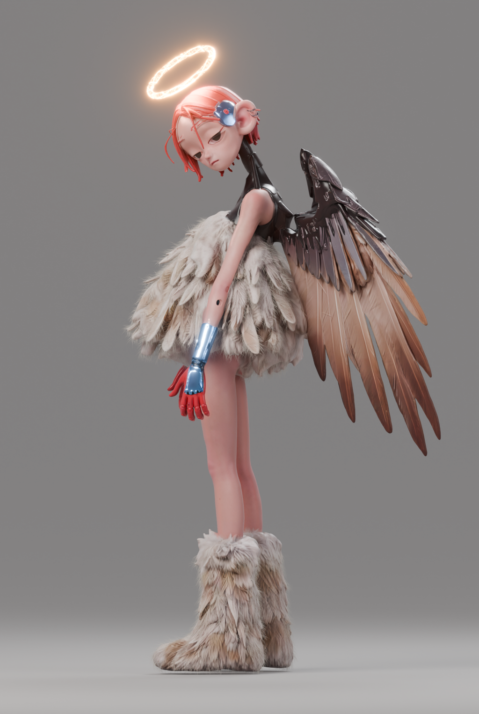
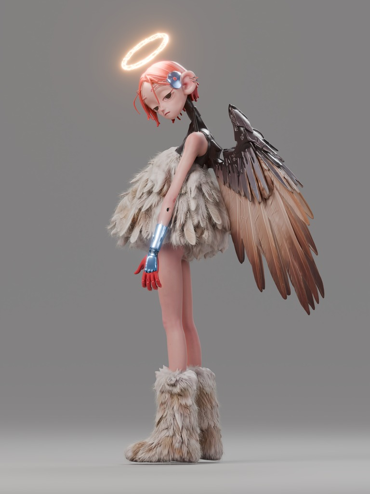
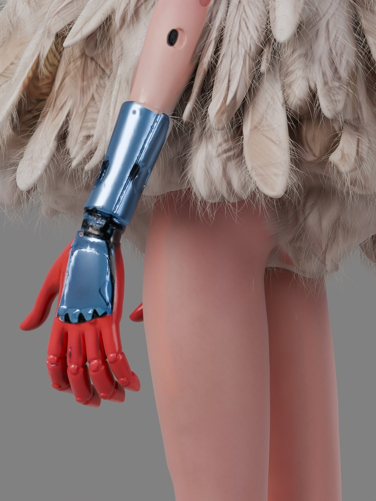
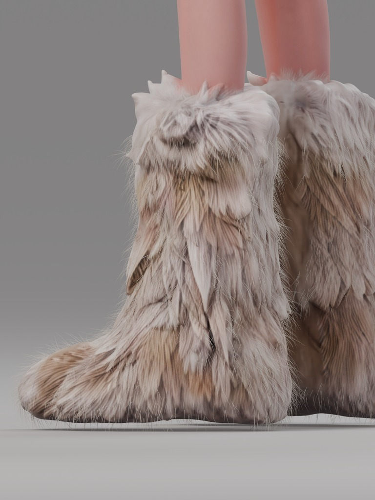
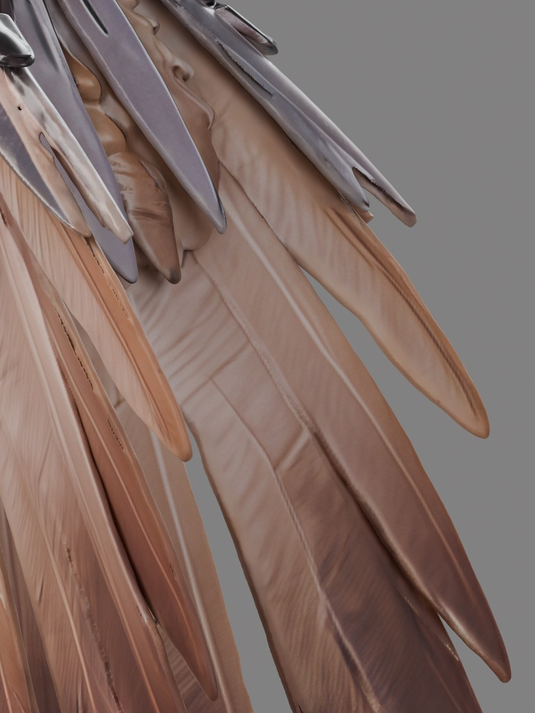
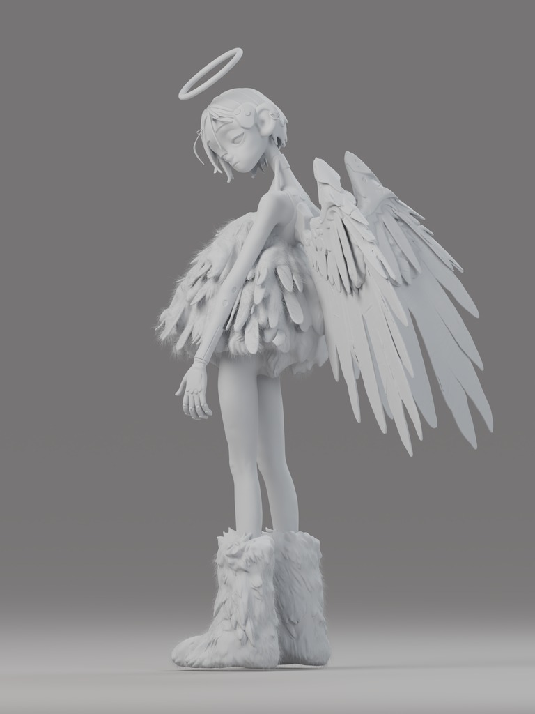

# 案例：机械羽翼角色

一张角色参考图 → Tripo 整体底模 → Blender 精修静帧 → 15 秒竖版展示片。

本案例提供真实 Blender 工程、成片预览和白模。Tripo 负责基础几何与贴图，Blender 完成光环重建、毛绒纤维、局部材质、灯光、合成辉光及相机动画。它不是从零手工建模，也不是经过动画级重拓扑的角色。

## 下载 Blender 工程

工程保存在 [案例 Release 下载页](https://github.com/huangxin-design/tripo-blender-ip/releases/tag/clockwork-angel-case-v1)，按需要单独下载即可。三份工程均内嵌三张 4096×4096 贴图；只下载 `.blend` 就能打开场景，不需要寻找原作者电脑上的路径。

| 文件 | 内容 | 范围 |
| --- | --- | --- |
| [静帧工程](https://github.com/huangxin-design/tripo-blender-ip/releases/download/clockwork-angel-case-v1/clockwork-angel-still-4k.blend) | 强辉光金色玻璃光环、蓝色金属、毛绒纤维、棚拍灯光 | 2748×4096 静帧 |
| [视频材质版工程](https://github.com/huangxin-design/tripo-blender-ip/releases/download/clockwork-angel-case-v1/clockwork-angel-video-beauty-4k.blend) | 全身、光环、金属、鞋子、羽毛五个相机镜头 | 3072×4096，24 fps，1–312 帧 |
| [视频白模版工程](https://github.com/huangxin-design/tripo-blender-ip/releases/download/clockwork-angel-case-v1/clockwork-angel-video-clay-4k.blend) | 真实场景几何的中性白模收尾 | 3072×4096，24 fps，313–360 帧 |

工程用 Blender **5.2.1 LTS** 保存并重新打开验证，建议先用相同版本查看。渲染前在自己的 Blender 中选择可用的设备；原工程使用 Cycles GPU。输出路径已改成工程旁的 `renders` 文件夹，渲染前确认该位置可写。打开文件只用于查看，渲染需自行启动。

视频由两份工程分别渲染后拼接，总长 15 秒。材质版的相机标记负责前五个镜头；白模版保留相同时间轴，在 313 帧开始。两份工程均没有自动渲染脚本，不能把材质版单独输出当作完整的六镜头成片。

下载文件的大小与 SHA-256 校验值见 [资产清单](assets.json)，重开与资源检查见 [工程验证记录](project-verification.json)。

## 细节与白模预览

下列图片从最终原生 4K 渲染帧缩小导出，没有重新生成画面或美化布线。全身静帧预览对应上方静帧工程；这些 3:4 截帧对应视频工程。

| 全身 | 发光光环 | 蓝色金属 |
| --- | --- | --- |
|  |  |  |

| 毛绒鞋子 | 羽毛与机械连接 | 真实白模 |
| --- | --- | --- |
|  |  |  |

[查看六个镜头的起、中、末帧总览](images/contact-sheet.jpg)

## 制作分工

| 部分 | Tripo 基础 | Blender 补足 |
| --- | --- | --- |
| 角色大形 | 人体、脸、服装、羽翼和机械件整体生成，基础 UV 与三张 PBR 贴图 | 匹配主视角、比例与构图，局部表面和颜色调整 |
| 金属 | 原始机械件形状与底色 | 蓝色金属分区、粗糙度、反射和受光层次 |
| 光环 | 原参考与底模提供位置依据 | 替换规则圆环，金色纹理玻璃、发光纹理、合成辉光与暖色溢光 |
| 毛绒与羽毛 | 保留衣服、靴子体积和主羽形 | 补充细纤维与轮廓毛感，避免纤维覆盖金属部位；不是重建全部主羽 |
| 交付画面 | 初始模型与贴图 | 棚拍灯光、色彩管理、真实分辨率重渲、单向运镜及白模 |

底模约 190 万三角面。脸部表情、眼睑和部分机械表面仍有生成痕迹，当前工程以此案例的静帧和小角度展示为目标，没有宣称具备整洁四边面、角色绑定或任意角度的完善结构。

## 镜头参考

0–4 秒全身 → 4–6 秒光环 → 6–8 秒金属 → 8–10.5 秒鞋子 → 10.5–13 秒羽毛 → 13–15 秒白模。运镜持续向同一方向，不倒转回开场；素材没有文案和音乐。

最终视频原生尺寸为 3072×4096，24 fps、360 帧；“4K”指长边 4096。历史渲染使用 Cycles / OptiX、自适应采样上限 64、降噪；这不是适用于所有场景的质量或耗时承诺。

完整说明见 [可选视频镜头建议](../../tripo-blender-ip/references/video-shot-suggestions.md)。本案例是展示与学习材料，安装 Skill、阅读案例或下载工程都不会自动制作视频。
